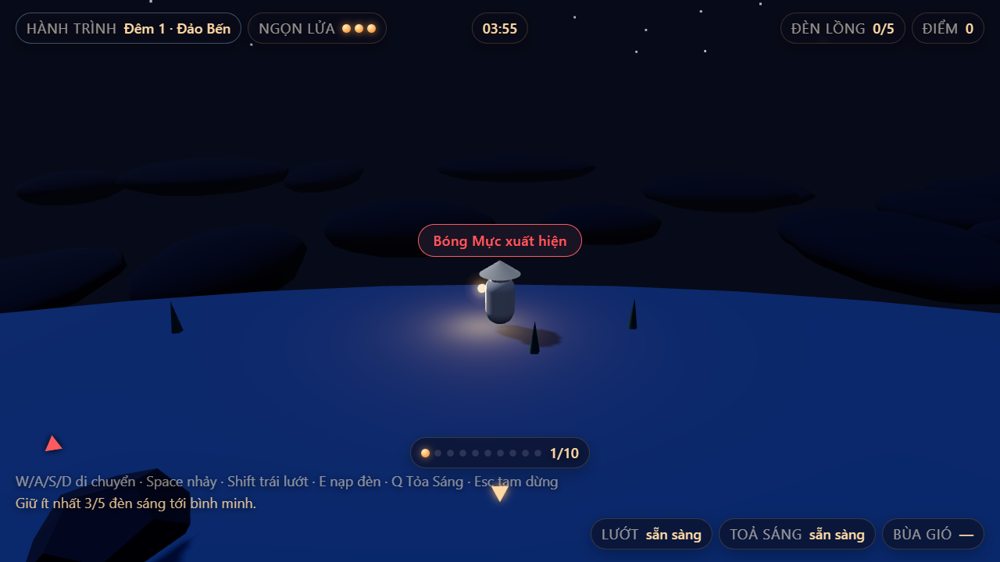

# Đảo Đèn Lồng

Game 3D góc nhìn thứ ba bằng Three.js và Vite. Hóa thân thành Mây, gom đom đóm và thắp lại Đèn Lồng Lớn qua ba đêm ở Đảo Bến, Đảo Cau và Đảo Chuông.



[Video demo MP4](docs/demo/demo.mp4) · [Bản web v1.0.0](docs/release/dao-den-long-v1.0.0-web.zip)

## Chơi ngay

Cần Node.js 22.12+ hoặc 24+, trình duyệt hỗ trợ WebGL 2 và độ phân giải khuyến nghị 1280×720. Benchmark cần Chrome, Chromium hoặc Edge cài trên máy.

```bash
npm ci
npm run build
npm start
```

Mở http://127.0.0.1:4173 nếu trình duyệt chưa tự mở. Bản ZIP đã build, giải nén rồi chạy `node tools/run.mjs` trong thư mục chứa `dist`.

| Điều khiển | Hành động |
|---|---|
| WASD / phím mũi tên | Di chuyển theo hướng camera |
| Space | Nhảy |
| Shift | Lướt |
| E | Nạp đom đóm vào đèn gần nhất |
| Q | Tỏa Sáng |
| Kéo / lăn chuột | Xoay / thu phóng camera |
| Esc / P | Tạm dừng |
| R / M | Chơi lại / tắt tiếng |

Mây phải sống tới bình minh và giữ ít nhất **3/5, 4/6, 5/7 đèn sáng** trong ba đêm dài lần lượt 240, 270 và 300 giây. Mỗi đèn cần 10 đom đóm để thắp lần đầu và 5 để thắp lại. Đèn tự hao 1 dầu mỗi giây. Nhấn E gần đèn đang sáng để châm dầu, mỗi đom đóm bổ sung tối đa 10 dầu. Mỗi lần thắp tăng sức chứa thêm 2, từ 10 đến tối đa 20.

Dưới 30 dầu, đèn nhấp nháy, mất vùng an toàn và có thể bị Bóng Mực hút dầu. Tỏa Sáng tốn 3 đom đóm. Gió Lạc cướp đom đóm, còn Bùa Gió tăng tốc chạy và bỏ hồi chiêu Lướt trong 10 giây. Chế độ **Bảng màu dễ phân biệt** nằm trong Cài đặt.

Cài đặt hỗ trợ đổi phím cho chín hành động, giảm chuyển động và phông chữ 18 px hoặc 22,5 px. Sau khi thua hoặc thắng cả hành trình, nhập tên 3–12 ký tự chữ Latin, số hoặc dấu gạch dưới để lưu tổng điểm các đêm thắng. Bản chạy từ `npm start` ghi top 10 trong `~/.dao-den-long/leaderboard.json`. Mỗi hành trình có một seed; chơi lại cùng đêm giữ seed. Chế độ dev dùng kho riêng trong trình duyệt.

```bash
node tools/run.mjs --export-leaderboard out.json
```

Mỗi đom đóm nạp được 5 điểm. Thắp lần đầu được 100, thắp lại được 40. Tỏa Sáng được 5 điểm mỗi Bóng Mực trúng đòn, hoặc 15 nếu con đó đang hút dầu. Khi thắng, mỗi đèn sáng được thêm 50 điểm cộng phần nguyên lượng dầu còn lại và mỗi Ngọn Lửa được thêm 50. Bình Minh hiển thị tổng điểm của ba đêm đã thắng.

## Headless và kiểm chứng

```bash
node tools/headless.mjs --seed 7 --night 3 --ticks 18000 --out out.jsonl
npm test
npm run verify
npm run build
```

CLI Test Contract v1.3 nhận đêm 1, 2 hoặc 3 và tùy chọn `--scenario`, `--inputs`, `--snapshot-every`. Snapshot tick 0 đứng trước mọi input. CLI dừng khi thắng/thua hoặc đạt số bước yêu cầu, ghi dòng `end` cuối và trả mã 0 (thành công), 1 (lỗi runtime) hoặc 2 (đối số/dữ liệu sai). Cùng seed, scenario và input cho kết quả giống hệt.

## Benchmark và soak

```bash
npm run build
npm run bench -- --seed 42 --duration 30 --out bench.json
npm run soak -- --seed 7 --nights 10 --out soak.json
```

Benchmark mở cửa sổ Chrome/Edge với viewport 1280×720, DPR 1. Dùng cờ Chromium để yêu cầu bỏ vsync GPU và giới hạn khung hình. Hệ điều hành hoặc compositor vẫn có thể áp nhịp hiển thị riêng. Có thể đặt `CHROMIUM_PATH` tới trình duyệt khác thuộc dòng Chromium. Thời gian tải tính từ tiến trình runner đến khung đầu, gồm thời gian khởi động trình duyệt. `peak_mem_mb` là `null` vì bản web không đọc RSS của trình duyệt. Số đo cục bộ dùng để tham khảo khi chấm trên máy chuẩn. Soak dùng RSS của một tiến trình Node.js và đo sau khi bộ thu gom rác chạy ở hai mốc.

- [Test Contract v1.3](game.contract.json)
- [Bằng chứng Phase 4](docs/proof/phase-4/README.md)
- [Retro bốn phase](docs/notes/retro.md)
- [Quyết định thiết kế và tiêu chí nghiệm thu Phase 3](docs/notes/phase-3-adr.md)
- [Bằng chứng Phase 3](docs/proof/phase-3/README.md)
- [Bằng chứng Phase 2](docs/proof/phase-2/README.md)
- [Bằng chứng lưu trữ Phase 1](docs/proof/phase-1/README.md)

Lõi mô phỏng nằm ở `src/sim/`. Cảnh Three.js, HUD và nhạc tổng hợp Web Audio nằm ở `src/render/`. Dùng `?photo=1&night=3` để xem cảnh minh họa tĩnh hoặc `?play=3` để kiểm tra riêng Đêm 3.

Giấy phép [MIT](LICENSE). Nguồn và công cụ được ghi trong [CREDITS.md](CREDITS.md).
